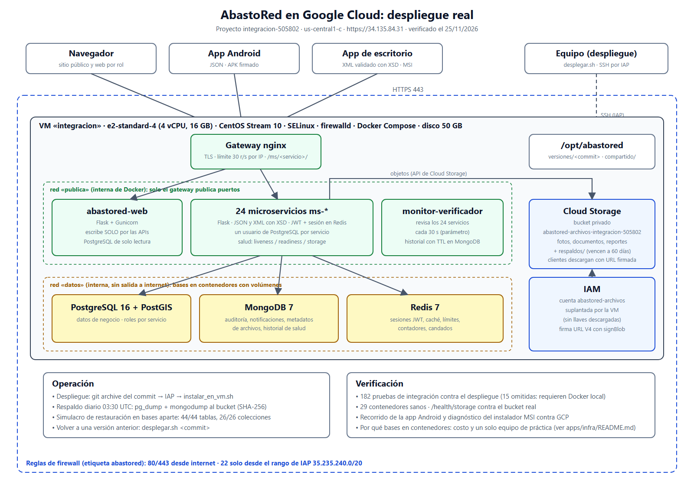

# Infraestructura

**Estado (25/11/2026):**

- **Local:** Docker Compose. 29 contenedores sanos al construir desde una descarga limpia.
- **Google Cloud:** desplegado y verificado en `https://34.135.84.31`:
  - 182 pruebas de integración;
  - bucket real con URL firmadas;
  - respaldo y simulacro de restauración.
- **Ubiquitous:** la página del proyecto está preparada en `apps/ubiquitous/`. Ese servidor solo sirve
  páginas estáticas, así que no corre el sistema.



## Local

Se levanta con `docker-compose.yml` en la raíz (ver el README principal). El sistema completo es:

- gateway nginx: el único con puertos publicados (80/443);
- web;
- 24 microservicios;
- `monitor-verificador`;
- PostgreSQL + PostGIS, MongoDB y Redis;
- `gcs-emulador`: emulador de Cloud Storage, solo en local.

Hay dos redes internas: `publica`, para el gateway y las aplicaciones, y `datos`, para las bases (sin
salida a internet).

## Google Cloud

| Recurso | Cómo está | Dónde se define |
| :--- | :--- | :--- |
| VM `integracion` | e2-standard-4 (4 vCPU, 16 GB), disco de 50 GB, CentOS Stream 10 con SELinux y firewalld, zona us-central1-c | `gcp/aprovisionar.sh` |
| Firewall | 80/443 desde internet y 22 solo desde Identity-Aware Proxy (35.235.240.0/20), para la etiqueta `abastored`. Las bases no publican puertos | `gcp/aprovisionar.sh`, `gcp/instalar_en_vm.sh` |
| Contenedores | `docker-compose.yml` + `docker-compose.gcp.yml` (emulador apagado, `restart: always`) | raíz del repo |
| Cloud Storage | Bucket privado `abastored-archivos-<proyecto>`: acceso uniforme, sin acceso público, versionado. `reportes/` vence a los 30 días y `respaldos/` a los 60 | `gcp/aprovisionar.sh` |
| Identidad | Cuenta `abastored-archivos` con `storage.objectAdmin` solo sobre el bucket. La VM la suplanta: no hay llaves descargadas. Las URL V4 se firman con `signBlob` (IAM Credentials) | `gcp/aprovisionar.sh` |
| Secretos | Se generan en la VM, en `/opt/abastored/compartido/secrets/` (carpeta 700). Nunca están en git ni en el paquete de despliegue | `gcp/instalar_en_vm.sh` |
| Certificado | Autofirmado, con la IP pública en el SAN. En el repo solo está la parte pública (`gcp/certificado_gateway_gcp.crt`) | `infra/gateway/05-certificado.sh` |
| Logs | Driver `json-file` con rotación (5 × 20 MB por contenedor). Cada petición queda en `bitacora_peticiones` con `correlation_id` | `gcp/instalar_en_vm.sh`, `libs/abasto_api` |
| Monitoreo | `monitor-verificador` revisa los 24 servicios cada 30 s y guarda el historial en MongoDB. Se ve en el web, en *Estado de los servicios* | `apps/microservicios/monitoreo` |
| Respaldos | Cron diario a las 03:30 UTC: `pg_dump` + `mongodump` al bucket, con SHA-256 | `gcp/respaldar.sh` |

### Por qué las bases van en contenedores y no administradas

Cloud SQL y Memorystore cuestan por hora aunque no se usen, y el proyecto es una sola VM de práctica.
Con contenedores, todo el sistema cabe en una máquina de unos US$0.13/h. Además, local y nube usan la
misma configuración, y el simulacro de restauración cubre el riesgo de perder datos. En producción real
convendría Cloud SQL, por los respaldos automáticos y la recuperación a un punto en el tiempo, y no
cambiaría el código: solo las variables de conexión.

### Operación

```bash
bash apps/infra/gcp/aprovisionar.sh                 # muestra el plan (no cambia nada)
bash apps/infra/gcp/aprovisionar.sh --aplicar       # crea/ajusta bucket, cuenta, permisos y firewall
bash apps/infra/gcp/desplegar.sh [commit]           # instala o actualiza; con un commit anterior, revierte
```

`desplegar.sh` hace tres cosas:

1. Empaqueta el commit con `git archive`, que incluye solo lo versionado.
2. Lo copia por SSH a través de IAP.
3. Ejecuta `instalar_en_vm.sh`, que:
   - instala Docker si falta;
   - deja la versión en `/opt/abastored/versiones/<commit>`;
   - conserva `.env`, los secretos y los volúmenes;
   - construye y espera a que los 29 contenedores estén sanos.

En la VM:

```bash
sudo /usr/local/bin/abastored-respaldar                                       # respaldo inmediato
sudo bash /opt/abastored/actual/apps/infra/gcp/probar_restauracion.sh <fecha>  # simulacro sin tocar datos
sudo bash /opt/abastored/actual/apps/infra/gcp/restaurar.sh <fecha>           # restauración real (pide confirmar)
```

Pruebas contra el despliegue:

```bash
PRUEBAS_HOST=https://34.135.84.31 PRUEBAS_CA=apps/infra/gcp/certificado_gateway_gcp.crt PRUEBAS_GCS_REAL=1 \
    python -m pytest tests/integracion -q -rs
```

Las evidencias están en `docs/evidencias/`: `pruebas_gcp/`, `respaldos_gcp/`, `movil_gcp/` e
`instalador_escritorio/`.

### Pendientes y riesgos conocidos

- **Reglas heredadas del proyecto GCP.** El proyecto lo comparte otra práctica del curso, y dos reglas
  suyas aplican a todas las VMs:
  - `default-allow-ssh` abre el 22 a todo internet;
  - `allow-libreria-gateway` abre el 8080.

  En la VM no hay nada escuchando en el 8080, y SSH acepta solo llaves. La zona de firewalld de la VM es
  `trusted` por la misma práctica. No se cambiaron porque no son de este proyecto. Para cerrarlas hay que
  quitar esas reglas, o limitarlas por etiqueta, cuando la otra práctica ya no las use.
- **Certificado autofirmado.** No hay dominio, así que el navegador muestra una advertencia. Con dominio
  se usaría un certificado de Let's Encrypt.
- **Sin balanceador ni segunda zona.** Si la VM falla, el sistema se cae. La recuperación es desplegar
  en otra VM y restaurar el último respaldo.
