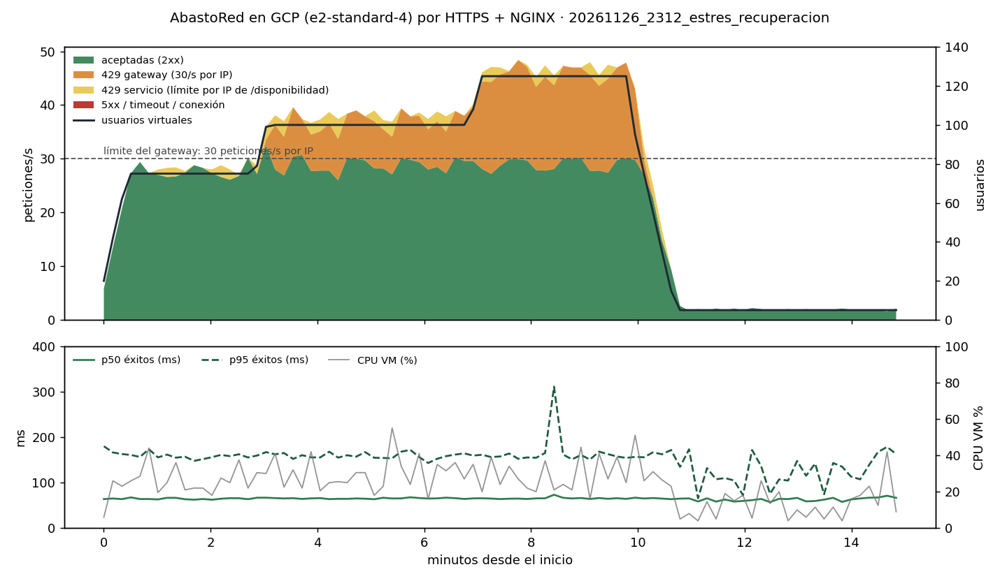

# Carga, estrés y recuperación en Google Cloud

**Fecha:** 26/11/2026, de 22:40 a 23:35 (hora del centro de México, UTC−6). Todo lo de este documento se
midió contra el **despliegue en Google Cloud**, entrando por la URL pública HTTPS y **a través de NGINX**. Los
resultados locales, sin gateway, siguen en [rendimiento.md](rendimiento.md) y son otra medición.

| Dato | Valor |
| :--- | :--- |
| Sistema medido | VM `integracion` (proyecto `integracion-505802`, `us-central1-c`): **e2-standard-4**, 4 vCPU Intel Xeon 2.20 GHz, 15.7 GB de RAM, 50 GB de disco, CentOS Stream 10, Docker 29.10.1 |
| Versión desplegada | commit `670ba4e`, el mismo código que `3a8cd6d` (lo que cambió después fue solo documentación); 30 contenedores en «healthy» |
| Entrada | `https://34.135.84.31`. TLS verificado con el certificado público del gateway; la huella SHA-256 del servido coincide con `apps/infra/gcp/certificado_gateway_gcp.crt` |
| Generador | Locust 2.32.2 en una laptop con Windows 11 (16 CPU lógicas, 32 GB), **fuera de GCP**, por internet. Latencia de red hasta la VM: ~47 ms (conexión TCP) |
| Scripts | `tests/carga/gcp/` sobre el commit `3a8cd6d`, todavía sin commit; el sha256 de cada script está en cada `ambiente.txt` |
| Datos | Base pequeña: ~300 usuarios, ~220 comercios, ~1 100 renglones de inventario, 23 MB. No se cargaron los datos masivos de la prueba local (1.3 M filas) |
| Otros procesos en la VM | Otro proyecto de una práctica anterior: servicios systemd `library-*` y `web-monolito`, con su propio PostgreSQL y Redis. Solo escuchan en `127.0.0.1` y estuvieron casi sin consumo. No se tocaron, pero comparten la VM |
| Resultados originales | `tests/carga/resultados/gcp/` (una carpeta por corrida) |

## 1. Metodología

### Escenarios

Son los mismos cuatro perfiles de la prueba local, con las rutas públicas reales:
`/ms/<servicio>/api/v1/...` y las páginas del web. Antes de cargar se verificaron métodos, rutas, permisos y
formatos con una corrida de 1 a 5 usuarios: 377 peticiones, 100 % correctas.

| Perfil | Peso | Peticiones | Formato |
| :--- | :---: | :--- | :---: |
| Comerciante (como la app Android) | 6 | inventario, avisos, comparación de precios, resumen de ventas, recomendaciones, pedidos y **registrar una venta** | JSON |
| Analista (como la app de escritorio) | 2 | cobertura por zona, brechas, agrupamientos (DBSCAN), comparación de precios, pronóstico y reportes | XML (se revisa el `Content-Type`) |
| Visitante (navegador) | 3 | inicio y disponibilidad del web, búsqueda y disponibilidad por API, sin cuenta | HTML/JSON |
| Auditor | 1 | bitácora, resumen y traza completa de una operación por `correlation_id` | JSON |

Locust reproduce **las peticiones** que hacen esos clientes. No mide cuánto tardan en dibujarse el web, Android o
el escritorio.

### Datos y cuentas de prueba

- Cada corrida usa un prefijo propio (`gcp1126b`): 90 comerciantes, 30 analistas y 15 auditores
  (`gcp1126b-com001@carga.abastored.test`…). Cada usuario virtual tiene su cuenta; no se comparte una sola.
- Las cuentas se crean dentro de `ms-seguridad`, con una contraseña aleatoria que no se guarda. Los tokens salen
  del mismo código del login: tienen su sesión en Redis y pasan por la validación normal de JWT y permisos.
  **El login queda fuera de la medición**, porque `POST /auth/login` admite 10 intentos por minuto y por IP, y
  todo sale de una sola IP.
- Cada comerciante dio de alta **su** comercio por la API (con zona asignada por ubicación) y 4 productos de
  100 000 unidades con precio. Las ventas son de 1 unidad, así que el stock nunca se agota por descuido.
- Cada venta lleva su `id_cliente`. Ante un error de red, timeout o 502–504 se reintenta **una vez con el mismo
  `id_cliente`**, como hace la app. No hizo falta ningún reintento.
- Los tokens quedan en `tests/carga/resultados/gcp/privado/`, fuera de git. Al final, las cuentas se desactivan
  y sus sesiones se revocan.

### Cómo se cuentan las respuestas

Cada respuesta se clasifica: **ok** (2xx), **429 del gateway** (encabezado `X-Limitado-Por: gateway`), **429 del
servicio** (`X-RateLimit-Limit`), **409** de negocio, **401/403**, otros 4xx, **5xx**, **timeout**, **error de
conexión** y **falla de contrato** (por ejemplo, se pidió XML y llegó otra cosa).

Los percentiles de Locust mezclan éxitos y rechazos. Un 429 del gateway tarda ~50 ms y, en una corrida con
muchos, *baja* el p95 global sin que el sistema vaya más rápido. Por eso se reportan aparte las latencias
**solo de las respuestas exitosas** (`resultados_por_categoria.csv` y `linea_tiempo.csv`).

### Plan, límites y condiciones de parada

Se definieron antes de ejecutar. La guardia los revisa cada 5 s; si se dispara alguna, la carga pasa a la fase
de recuperación.

| Concepto | Valor |
| :--- | :--- |
| Plan | verificación (1 → 5 usuarios) → carga (10, 25, 50; 3 min cada uno) → estrés (75 por 3 min, 100 por 4 min, **125 solo si 100 fue sano**) → recuperación (5 usuarios, 5 min) → verificación final |
| Incorporación | 1 usuario/s en la verificación; 2 usuarios/s en carga y estrés |
| Pausas entre tareas | 1–4 s el comerciante, 2–6 s el analista, 1–3 s el visitante y 2–5 s el auditor |
| Concurrencia máxima | 150 usuarios; duración máxima por corrida, 40 min |
| Parada | más de 5 % de 5xx, timeouts o errores de conexión durante 30 s; p95 de los éxitos > 3 s durante 60 s; 30 s sin respuestas; memoria de la VM < 1.5 GB; disco < 5 GB; cualquier reinicio u OOM de un contenedor |
| Escalar a 125 | solo si la etapa de 100 tuvo menos de 1 % de errores graves, p95 de éxitos < 1.5 s y CPU de la VM < 75 % |
| Límites activos (sin cambios) | gateway: 30 peticiones/s por IP, ráfaga de 60. Servicios: 120 peticiones/min por usuario y servicio. Públicos por IP: `/disponibilidad`, 60/min; `/buscar`, 120/min |

No se desactivó la autenticación ni ningún límite, no se alteró `X-Forwarded-For` y no se detuvo ningún
contenedor.

## 2. Resultados

Corridas: `20261126_2252_linea_base`, `20261126_2257_carga` y `20261126_2312_estres_recuperacion`. Las cifras
por etapa salen de las ventanas de 10 s de `linea_tiempo.csv`, sin contar la primera ventana de cada etapa ni las
de transición.

| Usuarios | Peticiones/s enviadas | Aceptadas/s | ok | 429 gateway | 429 servicio | 5xx / timeout / conexión | p50 éxitos | p95 éxitos | CPU VM prom / máx |
| ---: | ---: | ---: | ---: | ---: | ---: | :---: | ---: | ---: | ---: |
| 1 | 0.4 | 0.4 | 100 % | 0 | 0 | 0 | 78 ms | 119 ms | 8 / 16 % |
| 5 | 2.0 | 2.0 | 100 % | 0 | 0 | 0 | 65 ms | 121 ms | 12 / 28 % |
| 10 | 3.7 | 3.7 | 100 % | 0 | 0 | 0 | 64 ms | 150 ms | 14 / 41 % |
| 25 | 9.5 | 9.5 | 100 % | 0 | 0 | 0 | 65 ms | 155 ms | 15 / 34 % |
| 50 | 19.0 | 18.5 | 97.6 % | 0 | 2.4 % | 0 | 65 ms | 156 ms | 24 / 39 % |
| 75 | 28.3 | 27.6 | 97.4 % | 0 | 2.6 % | 0 | 64 ms | 156 ms | 27 / 44 % |
| 100 | 38.1 | **28.7** | 75.5 % | **21.1 %** | 3.3 % | 0 | 65 ms | 157 ms | 29 / 55 % |
| 125 | 47.0 | **28.9** | 61.5 % | **36.2 %** | 2.3 % | 0 | 65 ms | 157 ms | 29 / 44 % |
| 5 (recuperación) | 1.9 | 1.9 | 100 % | 0 | 0 | 0 | 63 ms | 124 ms | 13 / 42 % |

Totales de la corrida de estrés y recuperación (15 min): **23 755 peticiones**; 18 079 ok, 4 991 × 429 del
gateway y 685 × 429 del servicio. **0 respuestas 5xx, 0 timeouts, 0 errores de conexión, 0 respuestas 409, 0
respuestas 401/403 y 0 fallas de contrato XML.** Locust reporta, mezclando éxitos y rechazos: p50 59 ms, p95
150 ms, p99 190 ms y máximo 466 ms. Solo de los éxitos: p50 65 ms, p95 160 ms, p99 192 ms y máximo 466 ms.

En la carga (10 → 50 usuarios, 9 min) hubo 5 761 peticiones: 5 685 ok y 76 × 429 de `/disponibilidad`. No hubo
otro tipo de error.

Latencia de los éxitos por endpoint en la corrida de estrés, de 75 a 125 usuarios más la recuperación:

| Endpoint | p50 | p95 | p99 |
| :--- | ---: | ---: | ---: |
| `notificaciones GET /notificaciones/contador` | 51 ms | 56 ms | 66 ms |
| `inventario GET /comercios/{id}/inventario` | 67 ms | 80 ms | 99 ms |
| `busqueda GET /buscar` | 78 ms | 100 ms | 145 ms |
| `ventas POST /ventas` (escribe en ventas e inventario, y avisa) | 110 ms | 143 ms | 185 ms |
| `web GET /disponibilidad` | 111 ms | 126 ms | 170 ms |
| `recomendaciones GET /recomendaciones/{id}` | 150 ms | 207 ms | 234 ms |
| `auditoria GET /eventos` | 156 ms | 178 ms | 221 ms |
| `analisis GET /analisis/brechas` [XML] | 179 ms | 208 ms | 260 ms |



*Arriba: peticiones por segundo por tipo de respuesta y usuarios virtuales. Abajo: p50 y p95 de los éxitos y CPU
de la VM. Gráfica de la carga de 10 a 50 usuarios: [rendimiento_gcp_carga.png](diagramas/rendimiento_gcp_carga.png).*

Recursos durante el estrés: CPU de la VM con promedio de 23 % y máximo de 62 %. La memoria disponible nunca
bajó de 9.4 GB y el disco libre, de 39 GB. El steal fue de 0 %. No hubo reinicios de contenedores ni eventos
OOM, ni en Docker ni en el kernel. Los contenedores con más CPU fueron MongoDB (promedio de 14 %, picos de
~100 %, es decir, un núcleo, por momentos), PostgreSQL (13 %, máximo de 34 %), ms-inventario (7 %) y
ms-recomendaciones (5 %, máximo de 43 %). Un 100 % equivale a 1 vCPU. La laptop generadora no pasó de 52 % de CPU.

## 3. Cuellos de botella observados

1. **El límite del gateway por IP, no la VM.** A partir de ~75 usuarios desde una sola IP, las peticiones
   aceptadas se quedan en **~29 por segundo**, justo el límite de 30/s de NGINX. Con 100 y 125 usuarios, lo que
   pasa de ese límite recibe 429 en ~50 ms. Mientras tanto, la CPU de la VM promedió 29 % y la latencia de lo
   aceptado no cambió (p50 de 65 ms y p95 de 157 ms, igual que con 25 usuarios). **No se encontró el punto de
   saturación de la VM**: el límite del gateway lo impide con un solo generador. Que el gateway frene a una sola
   IP es el control esperado contra abuso; no es la capacidad máxima de procesamiento.
2. **El límite por IP de `/disponibilidad` (60/min).** Desde ~50 usuarios, todos los visitantes virtuales
   comparten la IP del generador y superan las 60 consultas por minuto de ese endpoint público. Con visitantes
   reales, cada uno tendría su propia IP.
3. **Endpoints más costosos.** Las brechas (XML), la bitácora y las recomendaciones rondan 150–180 ms de p50
   (unos 100–130 ms del servidor, descontando la red). Son los que calculan o agregan en cada petición, y no se
   degradaron dentro del rango probado.
4. **Picos de MongoDB.** MongoDB tuvo picos de un núcleo por momentos (la bitácora de cada petición y las
   consultas del auditor), sin efecto visible en la latencia.

## 4. Recuperación (tras sobrecarga, sin caídas provocadas)

Al terminar la etapa de 125 usuarios, la carga bajó a 5 usuarios (de 23:23:27 a ~23:24:20) y se mantuvo así
5 minutos.

| Momento | Qué se observó |
| :--- | :--- |
| ~20 s después de empezar a bajar (≤ 75 usuarios) | Dejan de aparecer los 429 del gateway |
| ~50 s (≤ 15 usuarios) | Dejan de aparecer los 429 de `/disponibilidad`; su ventana es de un minuto |
| Con 5 usuarios | p50 de 63 ms y p95 de 124 ms, contra 65 ms y 121 ms de la línea base con 5 usuarios. CPU de la VM, 13 % |
| Durante toda la corrida | ms-monitoreo reportó **24/24 servicios «ok», 0 degradados y 0 caídos** en cada muestra que respondió. Las 8 muestras sin respuesta válida coinciden exactamente con los periodos de 429 del gateway: la consulta de salud sale de la misma IP y también la limitó NGINX |

No hubo que «recuperar» ningún componente: ningún servicio falló ni se reinició. El tiempo de recuperación es lo
que tarda en vaciarse la ventana de cada límite: segundos para el gateway y hasta un minuto para el límite por
minuto de `/disponibilidad`.

**Verificación final** (`20261126_2329_verificacion_final`, 5 muestras cada 20 s):

- 24/24 servicios «ok» en cada muestra.
- Respondieron sin errores el web (`/` y `/disponibilidad`), la búsqueda, la cobertura en XML, el inventario y la
  bitácora. Mediana de 70 ms, contra 77 ms en la verificación inicial.
- Escritura controlada: la venta con `id_cliente` fijo dio 201 y su reenvío dio 200 con `duplicada: true`. El
  inventario bajó **exactamente 1**.
- **Consistencia de todos los datos de prueba:**
  - 360 renglones: en cada uno, la existencia inicial menos la actual es igual a la suma de sus salidas.
  - 1 017 ventas en la base: 1 015 aceptadas durante las corridas más las 2 de las verificaciones.
  - **0 `id_cliente` repetidos y 0 ventas aceptadas que falten o estén duplicadas.**
  - Las 199 ventas que recibieron 429 del gateway nunca llegaron al servicio y no aparecen en la base.

La recuperación tras una **caída deliberada** (detener ms-inventario o Redis) es otra prueba. Se hizo solo en
local ([rendimiento.md](rendimiento.md), sección 4) y no se repitió contra el despliegue.

## 5. Limitaciones

- **Una sola IP de origen.** El gateway limita a 30 peticiones/s por IP, así que esta prueba mide el sistema
  *con* sus controles hasta ese límite, no su capacidad máxima. Para encontrar la saturación por HTTPS harían
  falta varios generadores con IP distintas. Otra opción sería una prueba de backend dentro de la VM, sin NGINX,
  que compite por CPU y se reportaría aparte. Ninguna de las dos se ejecutó.
- **Datos pequeños** (23 MB). Con los 1.3 M de filas de la prueba local, los análisis y las búsquedas costarían
  más.
- **Una sola VM.** Todos los servicios, las bases y el gateway están en la misma VM, junto con otro proyecto
  inactivo. Esto no es alta disponibilidad: si la VM cae, cae todo.
- **La red pesa en la latencia.** Unos 47 ms de cada respuesta son el viaje de la laptop a `us-central1`. Las
  cifras dependen de la red del generador.
- **Duraciones cortas** (3–4 min por etapa). No se probó la estabilidad durante horas.
- Ni el login ni el renderizado de las apps entran en la medición. No se probaron caídas provocadas en GCP.
- **Corrida descartada.** La primera línea base (`20261126_2244_linea_base_DESCARTADA`) tuvo 409 `sin_zona` en
  recomendaciones: dos puntos de ubicación de la preparación quedaron fuera de las zonas. Fue un error de
  preparación, no del servidor. Se corrigió y todo se repitió con un prefijo nuevo. La carpeta se conserva con su
  explicación.

## 6. Comparación prudente con local

| | Local (`rendimiento.md`) | Google Cloud (este documento) |
| :--- | :--- | :--- |
| Máquina | 16 CPU y 15.6 GB para Docker | e2-standard-4: 4 vCPU y 15.7 GB |
| Entrada | Directo a cada contenedor, **sin NGINX** | **HTTPS público + NGINX** con límite por IP |
| Generador | En la misma máquina | Laptop por internet (~47 ms de red) |
| Datos | 1.3 M filas (283 MB) | ~23 MB |
| 100 usuarios | 38.2 peticiones/s; p50 19 ms; p95 170 ms | 28.7 aceptadas/s (tope del gateway); p50 65 ms; p95 157 ms de los éxitos |
| Errores de servidor | 0 × 5xx | 0 × 5xx |

Cambian a la vez la CPU, los datos, la red y el gateway, así que las diferencias **no se pueden atribuir solo a
GCP**. El p50 más alto en la nube se explica casi todo por la red: con ~47 ms de viaje, el servidor tarda unos
15–20 ms, del orden de lo medido en local. El tope de ~29 peticiones aceptadas por segundo lo pone el límite del
gateway, que en local no se atravesó. En ambos entornos se ve lo mismo: **ningún 5xx** dentro de lo probado, y
los rechazos que aparecen son los límites funcionando.

## 7. Cómo repetirlo

Las instrucciones exactas están en [tests/carga/gcp/README.md](../tests/carga/gcp/README.md). En resumen:

```bash
cp tests/carga/gcp/config.ejemplo.env tests/carga/gcp/config.env     # datos de tu VM
P=gcp$(date +%m%d)a
bash tests/carga/gcp/correr_gcp.sh preparar  $P
bash tests/carga/gcp/correr_gcp.sh verificar $P verificacion_inicial --muestras 3 --consistencia
bash tests/carga/gcp/correr_gcp.sh correr    $P linea_base "1:60,5:180" "" 1
bash tests/carga/gcp/correr_gcp.sh correr    $P carga "10:180,25:180,50:180" "" 2
bash tests/carga/gcp/correr_gcp.sh correr    $P estres_recuperacion "75:180,100:240,125?:180" "5:300" 2
bash tests/carga/gcp/correr_gcp.sh verificar $P verificacion_final --muestras 5 --consistencia
bash tests/carga/gcp/correr_gcp.sh limpiar   $P
```

## 8. Para explicarlo en clase (resumen breve)

> Probamos el sistema **desplegado en Google Cloud**, entrando por HTTPS y por el gateway NGINX como un usuario
> real, con cuatro tipos de cliente simulados: comerciante en Android (JSON), analista en escritorio (XML),
> visitante web y auditor. Cada usuario virtual tenía su propia cuenta. Subimos de 1 a 125 usuarios
> concurrentes desde una laptop.
>
> - **No hubo ningún error de servidor, timeout ni reinicio.** La latencia de lo aceptado se mantuvo estable:
>   ~65 ms de mediana y ~160 ms de p95, de los que ~47 ms son la red.
> - Desde ~75 usuarios aparece el **límite del gateway, 30 peticiones/s por IP**. Todo sale de una sola laptop,
>   así que NGINX responde 429 a lo que pasa de ese límite, mientras la VM sigue al ~30 % de CPU. Es el control
>   contra abuso funcionando; **no** encontramos el límite de la VM y no lo presentamos como tal.
> - Al bajar la carga, el sistema volvió a la línea base en menos de un minuto.
> - Las **1 015 ventas** aceptadas quedaron registradas una sola vez cada una, con el inventario cuadrado al
>   peso. El reenvío de una venta con el mismo `id_cliente` no la duplicó.
